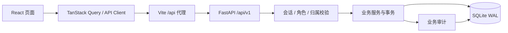
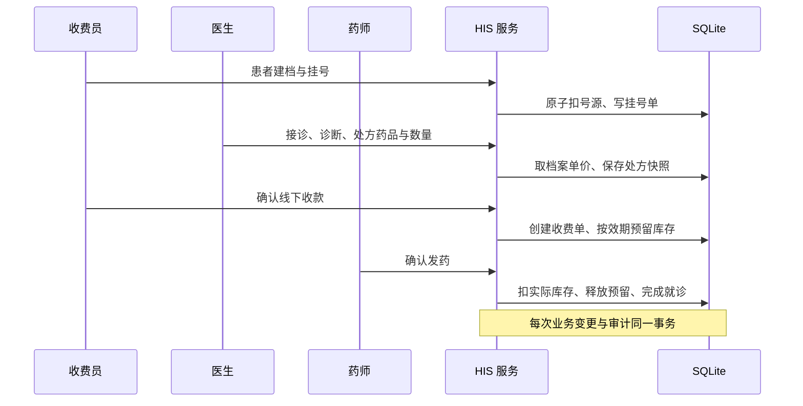
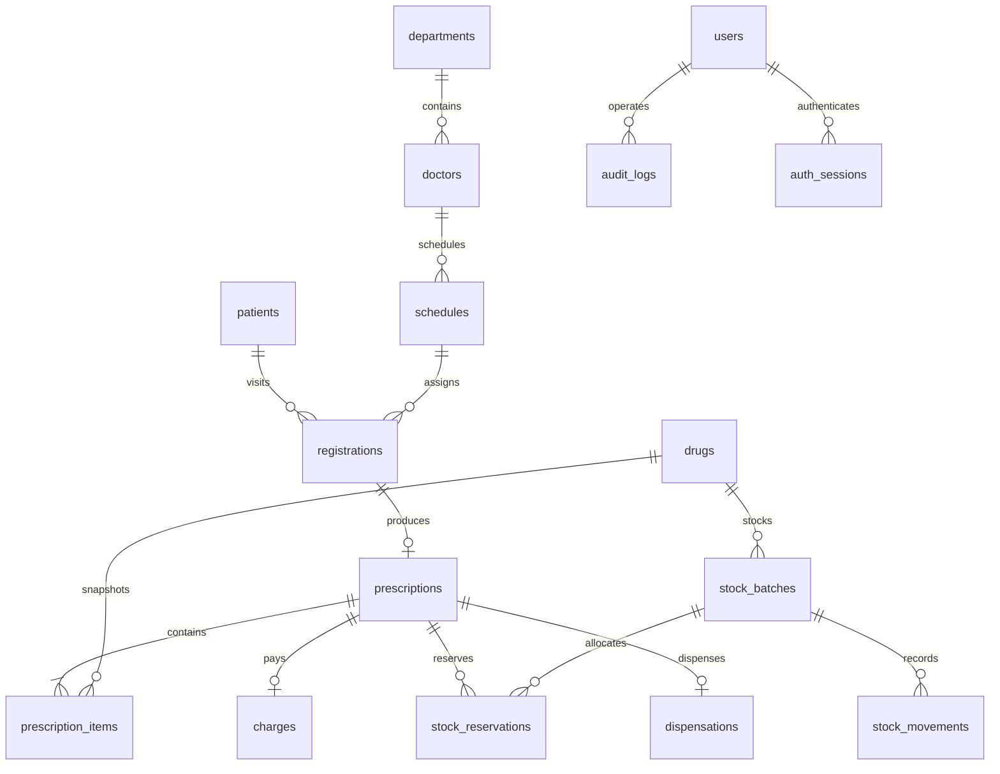

# dudu 医学系统开发文档

版本：1.0 · 日期：2026-10-26 · 状态：实现基线

本文是前后端开发、接口联调与验收的共同依据。变更业务规则时先更新本文，再同步代码和测试。用户指定 React + Vite + FastAPI + SQLite；所有实现围绕这一技术栈，不引入额外数据库或后端框架。

## 0. 资料理解与本次决策

已读取上一级的开发文档、前后端 AGENTS.md、现有前端布局与业务实现，以及第 4–12 课的文字内容。原项目作为业务参考，dudu 是可以独立启动的新目录；原课件保持原样。

| 资料 | 理解与落实 |
|---|---|
| 第 4 课：规范解读与立项选题 | 采用 A 门诊路线，患者、科室、医生、排班、挂号、处方、明细、药品、批次、收费单完整关联。保持一个清晰的业务闭环。 |
| 第 5 课：核心模块 | 挂号扣号源与生成排队号原子完成，按模块逐步验证。 |
| 第 6 课：药房与收费 | 后端计算费用；收费预留库存、药房实际出库，解决课件对扣库时点的简化表述。 |
| 第 7 课：角色权限 | 管理员、医生、收费员、药师；后端验证会话和医生记录归属，bcrypt 保存密码。 |
| 第 8 课：测试质量 | 验证号源并发、库存不足、重复付款与发药、退费、越权和真实浏览器闭环。课件“剩 1 个必失败”按正确业务规则修正为“剩 0 个才失败”。 |
| 第 9 课：运行方式 | 提供独立一键启动、固定依赖和环境模板。SQLite 是文件，不建独立数据库容器；本次为本地可运行交付。 |
| 第 10 课：标准与集成 | 保留诊断编码、药品五要素、批次效期、CSV 导入导出及业务审计。审计由业务事务写入，HTTP 日志不替代业务记录。 |
| 第 11 课：医疗 AI | 课程明确是可选加分项。本次不依赖模型服务，诊断和用药由医生填写，避免超出四项技术栈与简洁功能目标。 |
| 第 12 课：验收 | 使用虚构资料实际走通流程；留存测试命令、真实结果和界面截图，不把规划写成已通过。 |

### 0.1 本次视觉方向

- 品牌：dudu 医疗 / 嘟嘟社区医疗中心。主色 `#345cf3`，标题 `#18233d`，底色 `#f4f6fb`。
- 信息架构：工作台、门诊服务、药房中心、运营管理四个顶部入口；每组下方列清晰的业务页签。
- 首页：问候与日期、四项指标、就诊趋势、科室分布、待办数量和就诊列表，数据全部来自 API。
- 登录：浅蓝背景、居中登录卡与流程说明；不同角色可填入演示账号后登录。
- 业务页面：统一大标题、小型筛选条、宽表格和侧向信息区。挂号展示清晰的就诊步骤；接诊将候诊队列与病历并排；收费与发药保留确认摘要。
- 默认运行地址：前端 `http://127.0.0.1:5178`；后端 `http://127.0.0.1:8008`。与旧项目并行运行时互不占用默认端口。
- 开发顺序：本文与局部规范先完成，再移植经阅读确认的业务基础，重建 dudu 界面，最后在独立测试库和浏览器验证。

## 1. 项目背景与范围

依据当前目录第 4～12 课，选择 A 门诊路线，建设可运行的教学 HIS。品牌为“dudu 医疗”，采用虚构演示数据。业务主线为患者建档、预约挂号、医生接诊、开具处方、线下收款确认、药房发药、统计与审计。

### 1.1 已确定的设计决策

- [2026-10-26] 前端目录严格使用 `medicinefronted`，后端目录使用 `medicinebackend`。
- [2026-10-26] 本文先落盘，随后开始实现；不在运行中执行课件里的示例命令。
- [2026-10-26] 收费和发药是两次独立操作：收费时预留库存，发药时实际出库；未发药可退费并释放预留。此约定统一课件第 6 课的冲突表述。
- [2026-10-26] 最后一个号源允许被一个请求成功占用，其他请求返回冲突；号源为零才拦截。
- [2026-10-26] 全部产物位于 `dudu医学系统/`。本项目使用自己的 SQLite 数据文件和 `dudu_his_session` 会话 cookie，不依赖或写入原项目的数据库、密钥及运行目录。SQLite 为嵌入式数据库，通过后端的数据目录持久化，不启动“SQLite 数据库容器”。
- [2026-10-26] 门诊收费确认仅记录线下支付结果，不接入真实支付渠道。住院流程与模型 API 调用不属于本次门诊版本。

### 1.2 功能与验收范围

| 工作区 | 能力 | 主要使用者 |
|---|---|---|
| 工作台 | 今日指标、就诊趋势、科室分布、待办和近期业务 | 全部角色，数据按权限返回 |
| 患者档案 | 搜索、分页、新建、编辑、就诊历史、过敏记录 | 管理员、收费员、关联患者的医生 |
| 门诊挂号 | 科室和医生选择、号源查询、挂号、退号、排队号 | 管理员、收费员 |
| 医生排班 | 日期筛选、分时段排班、新增与调整号源 | 全部角色可查看，管理员维护 |
| 医生工作站 | 候诊列表、接诊、诊断、药品检索、处方明细 | 管理员、负责该门诊的医生 |
| 收费结算 | 未收费处方、费用明细、确认收款、未发药退费 | 管理员、收费员 |
| 药房发药 | 已缴费处方、预留批次检查、发药确认 | 管理员、药师 |
| 药品库存 | 药品检索、批次、低库存和效期提醒、入库、CSV 导入 | 管理员、药师；定价只允许管理员 |
| 统计报表 | 日期区间汇总、每日收入、科室统计、CSV 导出 | 管理员、收费员 |
| 操作日志 | 操作者、动作、对象和时间的检索与分页 | 管理员 |
| 系统设置 | 机构信息、账户新建、角色与启停管理 | 管理员 |

### 1.3 全局约束

**金额与时间。** 挂号显示医生诊查标准，但本教学版本仅对处方药费确认线下收款，挂号参考费不计入收入。 所有数据库和 API 金额使用整数分，字段后缀 `_cents`；前端仅格式化展示。处方单价在开方时从药品档案取得并形成快照，后续改价不改变旧处方。时间戳保存 UTC ISO 8601，业务日期按 Asia/Shanghai 计算，日期字段固定 `YYYY-MM-DD`。这些约束适用于全部模块。

**事务与并发。** 写操作使用 SQLite `BEGIN IMMEDIATE`，连接启用外键、WAL 和 5 秒锁等待。挂号的号源扣减、排队号递增、挂号单与日志同事务。收费的收费单、处方状态、批次预留与日志同事务。发药的扣库存、释放预留、出库流水、发药单、处方/挂号状态与日志同事务。失败全部回滚。忙锁返回 503 和明确重试提示。

**状态机。** 挂号：`waiting → in_progress → completed`，未开方可 `cancelled` 并释放号源。处方：`unpaid → paid → dispensed`；`unpaid → voided`；`paid → refunded`。已发药不能在本版本直接退费。收费单：`paid → refunded`。预留：`reserved → dispensed / released`。任何不合法跳转返回 409。

**输入与异常。** Pydantic 校验长度、枚举、日期和数量；SQL 必须参数化。400 表示业务输入错误，401 未认证，403 无权限，404 无对象，409 状态/资源冲突，422 字段校验失败，503 数据库暂忙。错误统一为 `{error: {code, message, details?}}`。未知异常不回传堆栈，服务端记录诊断日志。

**权限与隐私。** 登录使用 bcrypt 密码哈希与 JWT；JWT 放名为 `dudu_his_session` 的 HttpOnly、SameSite=Lax cookie，前端不保存 token。服务端检查会话有效性、当前账户状态和当前角色。修改请求携带 `X-Requested-With: his-web` 并检查 Origin。医生只能访问分配给自己的诊疗记录和相关患者，不返回收费流水或收入指标。原始身份证不接收、不保存，演示手机号与身份信息均为虚构；审计不得包含密码、token 或完整患者表单。

**幂等与审计。** 一个挂号单最多有一份处方，一份处方最多有一张收费单和一张发药单。重复收费/发药返回既有结果且不再扣减。审计在业务服务中记录语义明确的事件，与主数据同事务；HTTP 中间件负责安全、请求 ID 与错误处理，不能替代业务审计。

## 2. 工程结构与开发规范

```text
dudu医学系统/
  AGENTS.md                   开发入口与约束
  docs/HIS开发文档.md           本文
  README.md                   启动、演示账户、验证命令
  start.sh                    检查依赖并启动本地开发环境
  scripts/dev.py              管理本次启动的前后端进程与本地日志
  medicinefronted/
    src/api/                  请求封装与接口类型
    src/components/           公共布局、表格、弹窗、状态提示
    src/context/              登录状态、消息提示
    src/pages/                各业务页面
    src/lib/                  格式化与纯函数
    src/styles/               设计变量、布局和响应式样式
    tests/                    浏览器业务流程验证
  medicinebackend/
    app/config.py             环境配置
    app/database.py           连接、迁移与事务
    app/security.py           密码、会话与权限
    app/schemas.py            Pydantic 请求模型
    app/services/             业务事务与查询
    app/routers/              HTTP 路由
    app/migrations/           版本化 SQL
    app/seed.py                幂等演示初始化
    tests/                    业务与权限测试
    data/                     本地 SQLite、随机密钥（不提交）
```

### 2.1 前端开发规范

1. React + TypeScript 严格模式，Vite 构建，React Router 管理路由。组件使用 PascalCase，函数 camelCase，API 字段保留 snake_case，与后端一致。
2. 页面组件负责交互与编排，API 统一从 `src/api/client.ts` 发起，不在组件散落 fetch。使用 TanStack Query 管理服务端状态；写操作成功后刷新相关查询，禁用重复提交。
3. 所有接口定义类型；不以 `any`、禁用 TypeScript 检查或硬编码页面数据来掩盖接口问题。金额展示使用统一格式化函数，前端计算仅用于预览，以后端返回为准。
4. 表单具备可见标签、必填提示、数值范围、提交中状态和失败提示。确认收费、退费、退号、发药需展示对象和结果摘要。删除/停用不得用不可读的原生提示替代清晰的业务确认。
5. 每个数据区实现加载、错误、空数据状态。搜索支持防抖与服务器过滤，长列表分页，筛选变化重置页码。导出为实际后端数据，避免“按钮仅提示成功”。
6. 视觉使用冷白底、墨蓝文字与钴蓝主色，顶部全局导航配合横向业务页签；不使用原项目的宽侧栏与深绿主题。首页采用非对称数据网格、独立待办列与诊疗流程入口；登录页采用居中工作卡片与抽象医疗图形。统一 4/8px 间距，正文 14px，圆角 12–20px，辅助信息使用灰蓝色。状态同时使用文字与颜色。窄屏切换菜单和单列内容，表格允许横向滚动。
7. 弹窗以 portal 渲染到 body，支持 Escape、焦点限制与关闭后焦点恢复；处方打印仅显示处方文档；交互元素使用语义化 button/input，图标按钮有 aria-label，可用键盘操作，尊重 reduced-motion。
8. 路由和按钮根据角色呈现，403 仍由后端强制执行。登出清空 Query 缓存，避免不同角色共享敏感数据；401 自动返回登录。
9. 使用 Prettier 统一格式，执行 `npm run format`；验证命令：`npm run format:check`、`npm run lint`、`npm run build`。浏览器验证覆盖真实 API 的挂号、开方、收费、发药与权限边界，记录在 README 的验证说明中。

### 2.2 后端开发规范

1. Python 3.11+，FastAPI、Pydantic 2、标准库 sqlite3。使用同步路由执行 SQLite 操作，由 FastAPI 线程池调度，禁止在异步路由中直接做阻塞数据库操作。
2. 路由只处理输入输出和依赖，核心事务写入 services；连接由统一数据库工具管理，任何连接必须关闭。禁止字符串拼接用户输入到 SQL。
3. 请求模型限制额外字段，使用明确枚举和长度范围，数据库补充外键、唯一键和 CHECK 约束。更新操作不得直接接收客户端指定的权限、总价或状态。
4. 修改表结构必须新增迁移版本；启动按 schema_migrations 顺序执行，已有数据库不清空、不自动重建。变更前备份数据库，回滚用停止服务后恢复完整备份，不能在线删表模拟回滚。
5. 业务日期由服务端推导。患者编号、挂号号、处方号、收费号和发药号由服务端生成，避免客户端冲突；排队号在排班维度连续递增且退号不复用。
6. 密码哈希、JWT 密钥和数据库文件不提交。开发环境自动生成随机签名密钥；部署时可通过环境变量提供并启用 Secure cookie。CORS 仅允许明确的前端地址。
7. 药品按最早有效期优先预留和发药；过期、停用或可用数量不足必须拦截。所有库存数量均以药品档案计量单位计数，数量为正整数。已有库存批次或处方记录的药品不能修改规格和计量单位，规格变更应新建药品档案。
8. CSV 上传限制 2MB/2000 行，支持 UTF-8 BOM、UTF-8、GB18030；逐行校验，合法行去重入库，失败行返回行号和原因。药师导入不能创建/修改药品价格，管理员可以。
9. 测试使用独立临时数据库，不能操作运行数据。必须测试最后一个号源争抢、事务回滚、重复收费发药、退费释放预留、批次过期、医生数据归属、越权与恶意金额字段。
10. 日志不记录密码或 token。健康检查提供数据库可用性；配置在 `.env.example` 说明，依赖版本锁定，测试命令统一为 `python -m pytest`。

### 2.3 新增文件清单

| 状态 | 文件或目录 | 职责 |
|---|---|---|
| 🆕 | 前后端 `AGENTS.md` | 后续开发必须读取的局部规范 |
| 🆕 | `medicinebackend/app/migrations/001_initial.sql` | 建表与索引 |
| 🆕 | `medicinebackend/app/services/`、`routers/` | 下列业务模块的实现 |
| 🆕 | `medicinefronted/src/pages/` | 登录、工作台及全部业务工作区 |
| 🆕 | `medicinefronted/src/components/`、`styles/` | 共用交互与视觉系统 |
| 🆕 | 前后端 `tests/` | 关键规则和真实界面流程验证 |
| 🆕 | `README.md`、启动脚本和环境模板 | 可复现的本地运行方式 |

## 3. 架构与模块详细设计

### 3.1 架构概览





### 3.2 登录与账户
#### 1. 模块定位
提供登录、登出、当前用户和管理员账户维护。角色集合固定 admin / doctor / cashier / pharmacist。

#### 2. 核心服务接口
`login(db, username: str, password: str, context) -> User`，`logout(db, jti: str) -> None`，`save_user(db, payload, actor) -> User`。
| 入参 | 值来源 |
|---|---|
| username/password、账户资料 | 调用方传入 |
| actor/jti/IP | 系统推导（来源: 已验证 JWT、会话和请求） |
| 有效期、cookie Secure | 配置默认值（来源: SESSION_HOURS、COOKIE_SECURE） |

#### 3. 模块业务流程
登录校验账户与 bcrypt，创建有过期时间的会话，签发 JWT 并设置 cookie。每次请求验签后重读数据库账户和会话。登出删除会话与 cookie。管理员创建或调整账户时验证医生关联和最后一名管理员约束。

#### 4. 数据变更
users、auth_sessions、audit_logs。密码更新或停用撤销该账户的全部会话；不返回 password_hash。登录/登出与日志同事务。

#### 5. 实现锚点
security.py 提供 current_user 与 require_roles；JWT 的 sub 为用户 ID 字符串，jti 为随机会话标识，exp 为 UTC 时间。服务不能相信客户端传来的角色。

#### 6. 异常场景
密码错误抛 401；短时重复失败抛 429；数据库不可用抛 503。均遵循 §1.3，错误响应不泄漏账户是否存在。

#### 7. 关键行为场景
合法账户登录后 /me 返回当前角色；登出后同一 token 被拒绝。新增医生账户只能绑定已存在的医生。禁用账户立即失去访问权限，最后一名管理员始终保留。

### 3.3 患者档案与排班
#### 1. 模块定位
维护可检索患者档案与医生日期/时段号源，为挂号提供基础数据。依赖 §3.2 权限。

#### 2. 核心服务接口
`list_patients(db, filters, actor) -> Page`、`save_patient(db, payload, actor) -> Patient`、`save_schedule(db, payload, actor) -> Schedule`。
| 入参 | 值来源 |
|---|---|
| 姓名、出生日期、电话、过敏信息、排班容量 | 调用方传入 |
| patient_no、创建时间、已占号源数 | 系统推导（来源: 服务编号、时钟、现有排班） |
| page_size | 配置默认值（来源: 默认 20，最大 100） |

#### 3. 模块业务流程
患者先校验必填资料和出生日期，再生成编号入库。医生读取患者前检查存在本人负责的挂号单。排班以医生、日期、时段唯一，调整总量时按已占用量重算剩余量。

#### 4. 数据变更
patients、schedules、audit_logs。更新容量不能覆盖 next_queue_no；剩余量等于新总量减已占用量。

#### 5. 实现锚点
患者历史通过 registrations → schedules → doctors 关联；医生角色加 doctor_id 条件。排班响应包含医生与科室名称，前端不自行推算余额。

#### 6. 异常场景
未来出生日期抛 422；低于已预约数量的容量抛 409；锁等待超时抛 503，统一按 §1.3 处理。

#### 7. 关键行为场景
建档立即可搜索；修改过敏记录后接诊页能读到。总号源 20、已使用 5 时改为 12，剩余变为 7；改为 4 被拒绝且原数据不变。

### 3.4 门诊挂号
#### 1. 模块定位
原子完成号源占用、挂号单和排队号生成，并提供未开方退号。依赖患者、排班与认证。

#### 2. 核心服务接口
`register(db, patient_id: int, schedule_id: int, actor) -> Registration`，`cancel_registration(db, registration_id: int, actor) -> Registration`。
| 入参 | 值来源 |
|---|---|
| patient_id、schedule_id、registration_id | 调用方传入 |
| queue_no、registration_no、fee_cents | 系统推导（来源: 排班计数、编号生成器、医生收费标准） |
| status | 系统推导（来源: 状态机初始 waiting） |

#### 3. 模块业务流程
开启写事务，检查患者、排班日期和余量，以及同患者同排班是否已有有效挂号；扣减余额并递增排队号，插入挂号和审计。退号先检查无处方，再取消并恢复 1 个号源。

#### 4. 数据变更
schedules 的 remaining_slots/next_queue_no，registrations 和 audit_logs 原子写入。退号不复用旧排队号。

#### 5. 实现锚点
余额扣减 SQL 额外包含 remaining_slots > 0 条件并核验 rowcount。数据库约束余额非负。医生仅能启动自己排班下的接诊。

#### 6. 异常场景
号源耗尽、重复挂号、已开方退号抛 409；数据库锁超时抛 503。事务回滚后由 §1.3 返回统一错误。

#### 7. 关键行为场景
正常挂号产生唯一编号与队列位置，余量恰好减 1；并发竞争最后一个号源仅一人成功。退号余量加 1，重复退号不再次增加。

### 3.5 接诊与处方
#### 1. 模块定位
医生对自己的门诊接诊、记录诊断并开具结构化处方。依赖挂号、药品档案和用户医生关联。

#### 2. 核心服务接口
`start_consultation(db, registration_id, actor) -> Registration`，`create_prescription(db, payload, actor) -> Prescription`，`void_prescription(db, id, reason, actor) -> Prescription`。
| 入参 | 值来源 |
|---|---|
| registration_id、诊断、诊断编码、主诉、备注、药品用法及数量 | 调用方传入 |
| 医生 ID、药品名称/规格/单价、处方总额 | 系统推导（来源: 排班和药品档案） |
| 处方编号与 unpaid 状态 | 系统推导（来源: 编号生成器、状态机） |

#### 3. 模块业务流程
校验归属与挂号状态，拒绝重复药品、停用药品、无效数量。读取药价并保存快照，汇总整数分总额。挂号置 in_progress，处方置 unpaid。未收费处方可作废，并完成该次就诊记录。候诊队列通过 pending_only 由后端筛出尚未开方的 waiting/in_progress 挂号，按挂号顺序分页，避免已完成记录挤占队列。

#### 4. 数据变更
prescriptions、prescription_items、registrations、audit_logs 同事务。开方不扣库存，不接受客户端价格。

#### 5. 实现锚点
items 是对象数组，quantity 为正整数，dosage 为每次用量文字，frequency 为服用频次文字；drug_id 唯一。患者过敏信息只供医生核对，不由系统自动产生临床判断。

#### 6. 异常场景
越权抛 403，挂号已完成/重复开方抛 409，药品不存在抛 404；写入失败回滚并按 §1.3 处理。

#### 7. 关键行为场景
开方后收费台显示同一份明细和总额；修改药品价格不改变该处方。收费员直接请求开方接口得到 403。已收费处方不能作废。

### 3.6 收费与退费
#### 1. 模块定位
记录线下收款并预留药品，处理未发药退费。依赖 §3.5 处方和库存批次。

#### 2. 核心服务接口
`charge_prescription(db, prescription_id, payment_method, actor) -> Prescription`，`refund_prescription(db, prescription_id, reason, actor) -> Prescription`。
| 入参 | 值来源 |
|---|---|
| prescription_id、payment_method、reason | 调用方传入 |
| 收款金额、批次与预留量 | 系统推导（来源: 处方快照与有效批次可用量） |
| 收费员、时间、单号 | 系统推导（来源: 当前用户、时钟、编号生成器） |

#### 3. 模块业务流程
锁定写事务，paid/dispensed 重复收费返回既有结果。unpaid 处方按效期优先分配全部明细，确认无缺口后更新各批次预留，插入收费单并标 paid。退费仅接受 paid，释放所有 reserved 记录并将收费和处方标 refunded。

#### 4. 数据变更
charges、stock_reservations、stock_batches.reserved_quantity、prescriptions、audit_logs。quantity 不在收费时变化。

#### 5. 实现锚点
可用量 = 未过期批次 quantity - reserved_quantity；批次以 expires_at,id 升序分配；收费单 prescription_id 唯一。退费原因必填，支付方式只是线下记录。

#### 6. 异常场景
任何药品不足、批次无效或已发药退费抛 409；事务中任何 SQL 失败全部回滚，交给 §1.3。

#### 7. 关键行为场景
收费成功后实际库存不变、可用量减少，药房可见处方。重复确认不会重复预留。多药处方后一项不足时，前一项的预留也不保留。退费后可用量全部恢复。

### 3.7 药房发药
#### 1. 模块定位
药师依据已付款处方完成核对和实际出库。依赖收费预留。

#### 2. 核心服务接口
`dispense_prescription(db, prescription_id: int, actor) -> Prescription`。
| 入参 | 值来源 |
|---|---|
| prescription_id | 调用方传入 |
| 预留批次、数量、患者与处方明细 | 系统推导（来源: 已付款处方与 reserved 记录） |
| 发药号、药师、时间 | 系统推导（来源: 编号生成器、会话、时钟） |

#### 3. 模块业务流程
检查 paid，核对药品仍启用、所有预留批次未过期且数量有效；一个事务内 quantity 和 reserved_quantity 同量递减，插入出库流水与发药单，置处方 dispensed、挂号 completed。已 dispensed 重复请求返回原结果。

#### 4. 数据变更
stock_batches、stock_reservations、stock_movements、dispensations、prescriptions、registrations、audit_logs。每张处方仅一张发药单。

#### 5. 实现锚点
仅使用收费时的预留分配，不再根据当前可用总量任意扣另一批次。库存 CHECK 是最终约束。

#### 6. 异常场景
未收费或付款后预留批次过期抛 409，并提示退费后重新处理；SQL 失败按 §1.3 回滚，不能出现部分药已发。

#### 7. 关键行为场景
核对明细后发药，所有批次精确扣减、余额不为负，报表和审计可追溯。重复发药库存与流水均不再变化。

### 3.8 药品、入库与导入
#### 1. 模块定位
维护标准药品档案、批次入库、效期和低库存提醒，提供受限 CSV 批量导入。

#### 2. 核心服务接口
`save_drug(db, payload, actor) -> Drug`、`receive_stock(db, payload, actor) -> Batch`、`import_drugs(db, rows, actor) -> ImportResult`。
| 入参 | 值来源 |
|---|---|
| 药品档案、批次、数量、效期、CSV 文件 | 调用方传入 |
| available_stock、reserved_stock、预警状态 | 系统推导（来源: 有效批次聚合与阈值） |
| 文件与行数上限 | 配置默认值（来源: 2MB / 2000 行） |

#### 3. 模块业务流程
管理员维护药品和价格，药师只能查看与入库。单笔入库检查有效期和批次一致性，再增加数量与流水。CSV 逐行解析并使用保存点隔离错误；新药管理员创建，已有药校验档案；相同药品和批次跳过，避免重复导入增库。

#### 4. 数据变更
drugs、stock_batches、stock_movements、audit_logs。单笔入库同事务，CSV 合法行可提交且错误行无部分残留。

#### 5. 实现锚点
CSV 列为 drug_code,generic_name,trade_name,specification,dosage_form,unit,price_cents,insurance_category,manufacturer,stock_threshold,batch_no,quantity,expires_at。返回 success_count,skipped_count,failed_count,errors[{row,message}]。

#### 6. 异常场景
过期入库/不一致批次抛 409；乱码或缺表头抛 400；超大上传抛 413；逐行错误作为结果返回，系统数据库错误按 §1.3 处理。

#### 7. 关键行为场景
入库后批次与可用量同步增加，低库存提示消退。导入 3 行中 1 行非法时，2 行成功并返回错误行号；再次导入不重复增库。药师篡改价格接口得到 403。

### 3.9 工作台、报表与审计
#### 1. 模块定位
从真实业务数据计算工作台、区间报表及可检索审计，禁止前端伪造统计数字。

#### 2. 核心服务接口
`dashboard(db, actor) -> Dashboard`、`report(db, start_date, end_date, actor) -> Report`、`list_audit(db, filters, actor) -> Page`。
| 入参 | 值来源 |
|---|---|
| 区间、搜索、动作、页码 | 调用方传入 |
| 当前业务日、角色过滤范围 | 系统推导（来源: 服务时钟、当前用户） |
| 趋势范围 | 配置默认值（来源: 工作台最近 7 天） |

#### 3. 模块业务流程
校验角色与日期范围，按业务日聚合有效挂号、处方、支付与退费；工作台返回待办与真实预警。医生统计仅含本人业务且收入字段为 null。报表 CSV 与页面使用同一查询。

#### 4. 数据变更
N/A — 本模块不涉及数据写入。

#### 5. 实现锚点
收入以支付日期入账、退费日期冲减；报表另列收款和退费。audit details 是服务控制的 JSON 对象，不包含任意原始 HTTP body。CSV 文本对 =,+,-,@ 前缀做公式注入防护。

#### 6. 异常场景
反向日期或超一年查询抛 422；医生访问财务接口抛 403；数据库异常按 §1.3 返回 503/500，不以虚构数据兜底。

#### 7. 关键行为场景
完成一笔收款后今日收入增加；退费后在退费日期扣减；同一日期区间页面与导出一致。管理员能够查到刚才发药的操作者和处方编号。

### 3.10 机构设置
#### 1. 模块定位
维护机构展示信息，作为登录页、工作台和报告的一致名称来源。

#### 2. 核心服务接口
`read_settings(db) -> Settings`，`update_settings(db, payload, actor) -> Settings`。
| 入参 | 值来源 |
|---|---|
| hospital_name、phone、address | 调用方传入 |
| 操作者、更新时间 | 系统推导（来源: 会话与时钟） |
| 首次机构名 | 配置默认值（来源: 演示初始化“嘟嘟社区医疗中心”） |

#### 3. 模块业务流程
读取允许公开的机构字段；管理员提交校验后的完整字段，事务 upsert 设置并记录字段名级别审计。

#### 4. 数据变更
settings、audit_logs，原子保存。

#### 5. 实现锚点
仅允许固定白名单键，禁止通过设置接口改 JWT 密钥、文件路径或初始化选项。

#### 6. 异常场景
非管理员写入抛 403；名称为空抛 422；数据库写入失败按 §1.3 回滚。

#### 7. 关键行为场景
管理员修改机构名后刷新页面和登录页均显示新名称；药师请求修改被拒绝且数据不变。

## 4. HTTP 接口契约

前缀 `/api/v1`。成功响应直接返回对象；列表返回 `{items, total, page, page_size}`，page 从 1 开始，page_size 默认 20、最大 100。身份由 cookie 推导，修改请求统一携带 `X-Requested-With: his-web`。创建返回 201，其余成功返回 200（文件导出除外）。字段限制以 schemas.py 和 FastAPI `/docs` 为可执行契约，接口调整必须同步本文及前端 types。

| 方法与路径 | 请求或筛选 | 响应与业务异常 |
|---|---|---|
| GET `/health`、`/meta` | 无 | 健康状态；机构名、业务日期、演示模式 |
| POST `/auth/login` | username, password | 当前用户，设置 cookie；401/429 |
| GET `/auth/me` / POST `/auth/logout` | 会话 | 当前用户 / 登出成功；401 |
| GET/POST `/users` | username, display_name, role, password, doctor_id? | 账户列表/新账户；403/409 |
| PATCH `/users/{id}` | display_name?, role?, active?, password?, doctor_id? | 账户；不能停用最后一名管理员 |
| GET `/departments`、`/doctors` | department_id? | 科室或医生数组 |
| GET/POST `/patients` | q, page；full_name, gender, birth_date, phone, allergies, address | 患者分页/患者详情；422 |
| GET/PATCH `/patients/{id}` | 与新建字段相同 | 患者、就诊历史；403/404 |
| GET/POST `/schedules` | date, department_id, doctor_id；doctor_id,date,period,total_slots | 排班数组/排班；409 |
| PATCH `/schedules/{id}` | total_slots | 调整后的剩余号源；低于已占用量返回 409 |
| GET/POST `/registrations` | date,q,status,doctor_id,pending_only,page,page_size；patient_id,schedule_id | 挂号列表/挂号单；pending_only=true 返回待接诊队列；409 |
| POST `/registrations/{id}/cancel`、`/start` | 无业务字段 | 挂号单；403/409 |
| GET/POST `/prescriptions` | status,q,date,page；registration_id,diagnosis,diagnosis_code,chief_complaint,notes,items | 处方列表/处方详情；409/422 |
| GET `/prescriptions/{id}` | 无 | 处方与药品快照、支付/发药信息；403/404 |
| POST `/prescriptions/{id}/void` | reason | 未收费处方作废；409 |
| POST `/prescriptions/{id}/charge` | payment_method: cash/wechat/alipay/card | 收费单与处方状态；库存不足 409 |
| POST `/prescriptions/{id}/refund` | reason | 退费结果，释放预留；已发药 409 |
| POST `/prescriptions/{id}/dispense` | 无业务字段 | 发药结果；未收费/批次过期 409 |
| GET/POST `/drugs` | q,low_stock,expiring,page；药品档案字段 | 药品分页/药品；药师写档案 403 |
| PATCH `/drugs/{id}` | 药品档案字段 | 更新档案；403/422 |
| GET `/drugs/{id}/batches` | 无 | 批次数量、预留量、效期 |
| POST `/stock/receive` | drug_id,batch_no,quantity,expires_at | 批次与入库流水；409/422 |
| POST `/drugs/import` | multipart CSV file | 成功、跳过、失败计数及错误行；400/413 |
| GET `/drugs/import-template` | 无 | UTF-8 BOM CSV 模板 |
| GET `/dashboard` | 无 | 按角色裁剪的指标、7 日趋势、科室分布、待办 |
| GET `/reports`、`/reports/export` | start_date,end_date | 汇总/每日/科室数据；CSV 导出；403 |
| GET `/audit-logs` | q,action,page | 脱敏审计分页；403 |
| GET `/search` | q | 按角色过滤的患者或药品快捷搜索结果 |
| GET/PUT `/settings` | hospital_name,phone,address | 机构配置；修改 403 |

处方 items 为 `[{drug_id: int, quantity: int, dosage: string, frequency: string}]`，不接收价格或总额。药品档案字段为 `drug_code,generic_name,trade_name,specification,dosage_form,unit,price_cents,insurance_category,manufacturer,stock_threshold,active`。性别枚举 male/female/other，period 枚举 morning/afternoon，insurance_category 枚举 A/B/self。

## 5. 数据存储

所有主键为 SQLite `INTEGER PRIMARY KEY`，会话 jti、配置 key 除外。SQL 以带注释的 SQLite DDL 编写，金额为 INTEGER，布尔为 0/1，日期为 TEXT，JSON 为受控序列化的 TEXT。



| 表 | 关键字段与约束 | 索引 |
|---|---|---|
| departments | name 唯一、location、color | uk_department_name |
| doctors | department_id 外键、name、title、specialty、consultation_fee_cents | idx_doctor_department |
| users | username 唯一、bcrypt 哈希、角色、doctor_id、active | uk_user_username |
| patients | patient_no 唯一、姓名、性别、出生日期、虚构电话、过敏、地址 | idx_patient_name |
| schedules | doctor_id/date/period 唯一；total ≥ remaining ≥ 0；next_queue_no | uk_schedule_slot |
| registrations | registration_no 唯一、patient_id、schedule_id、queue_no、状态、fee_cents | idx_reg_schedule、idx_reg_patient |
| prescriptions | registration_id 唯一、医生、诊断及编码、总额、状态 | idx_rx_status |
| prescription_items | 药品、名称/规格/价格快照、数量、用法、频次 | idx_rx_item_parent |
| drugs | drug_code 唯一、档案、整数单价、阈值、active | idx_drug_name |
| stock_batches | drug_id/batch_no 唯一；quantity ≥ reserved_quantity ≥ 0；expires_at | idx_batch_expiry |
| charges | prescription_id 唯一、amount_cents、支付方式、收费员、状态及退费原因 | idx_charge_paid_at |
| stock_reservations | prescription_id、batch_id、quantity、status | idx_reservation_rx |
| dispensations | prescription_id 唯一、pharmacist_id、时间 | idx_dispense_time |
| stock_movements | batch_id、drug_id、quantity_delta、type、reference_no、operator_id | idx_movement_batch |
| audit_logs | 操作者快照、动作、对象、脱敏 details、IP、时间 | idx_audit_time |
| auth_sessions | jti 主键、user_id、expires_at | idx_session_user |
| settings | key 主键、value | 主键 |
| schema_migrations | version 主键、applied_at | 主键 |

完整正向 SQL 写入 `medicinebackend/app/migrations/001_initial.sql`，是本节字段约束的可执行版本。迁移版本记录与对应结构变更在同一事务提交。开发数据自动初始化一次，后续启动保留业务数据；测试使用临时目录。

**回滚方案：** 迁移前用 SQLite backup API 创建一致性备份，记录迁移版本；回滚时先停止后端，保留当前数据库作为事故快照，用备份恢复数据库并删除失效的 WAL/SHM 辅助文件，再以相应旧版本代码启动。初始迁移无历史数据时可恢复空数据库备份。禁止在有业务写入的数据库执行 DROP TABLE。

## 6. 非功能与视觉标准

- 本版本为单机构、单应用实例的本地教学应用。SQLite 写入串行，列表分页，避免长事务和导入期间网络请求。
- 普通页面用骨架或轻量加载状态，搜索防抖 250ms，提交中按钮禁用。错误保留表单输入，重试读取不重复写入。
- 表格信息层级为“主标识 + 次要说明 + 状态 + 对齐的数值 + 明确操作”；金额右对齐，操作不仅靠图标表达。
- 宽屏使用双层顶部导航，内容最大宽度 1560px；1100px 以下压缩网格，768px 以下展示导航菜单和单栏表单。布局、品牌与登录页均独立于上一级 medicinefronted。
- 日志与数据库只在本地，演示数据为虚构。服务默认监听 127.0.0.1，公网部署属于独立运维步骤。
- 业务正文与输入框使用 13–14px，辅助业务文本至少 12px；品牌装饰英文和非业务页脚可缩小。浅色背景上的业务文本保持足够对比度。

## 7. 开发与验收顺序

1. 落盘本文、AGENTS 规范和启动说明。
2. 实现数据库迁移、演示初始化、认证、权限及业务 API。
3. 实现设计系统、登录、工作台，再逐个接入完整门诊工作区。
4. 在临时库验证业务事务、并发和权限；执行前端 lint 与构建。
5. 启动本地前后端，在浏览器中完成患者建档、挂号、开方、收费、发药、日志查询，并检查窄屏布局。
6. 同步实际命令、账户、测试结果与已知限制到 README，不将未执行的检查写成通过。

### 7.1 必须满足的业务场景

- 号源只剩 1 个时，竞争请求只有一个成功；失败请求不产生挂号单。
- 药品改价不影响已有处方；前端篡改总额或单价不能改变收费金额。
- 收费使可用库存减少、实际库存不变；发药使实际库存减少，预留同步释放。
- 一张处方重复收费或发药不能产生重复单据、扣库或审计事件。
- 库存不足或过期时全事务回滚，未发药退费完全释放预留；已发药退费被拦截。
- 收费员不能开方、药师不能改价、医生不能读收费流水或其他医生的就诊记录。
- CSV 合法行写入，错误行返回具体原因；重复药品/批次不重复增加库存。
- 操作完成后，管理员可以检索到准确的审计记录；登出后会话立即失效。

### 7.2 本地启动与测试隔离

根目录 `./start.sh` 检查 Node 版本与 Python 虚拟环境，缺少依赖时安装锁定依赖，再启动 FastAPI :8008 与 Vite :5178。进程日志位于 `.local/logs`。端口被占用时明确报错；Ctrl+C 只终止本次启动的进程组，不操作其他服务。

浏览器测试使用独立端口 :18008 / :15178，由 `medicinebackend/scripts/e2e_server.py` 创建临时数据库；测试结束清理，不连接本地业务库。后端测试也基于临时数据库。演示种子仅首次初始化，跨日后需在排班页面按需新增排班，不为保持示例数字而覆盖已有业务数据。
