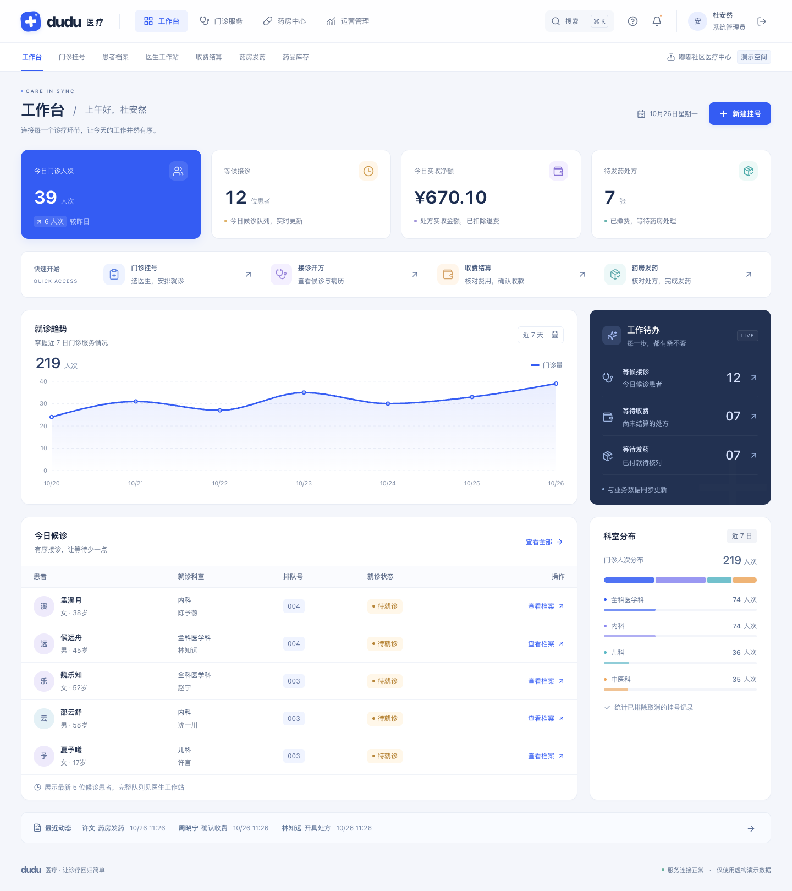

# dudu 医学系统验收记录

验收日期：2026-10-26。范围：本地门诊教学版本 1.0，React + Vite + FastAPI + SQLite。

本记录只包含本次实际执行的检查。开发依据为 [HIS 开发文档](HIS开发文档.md)，启动方式及演示账号见 [README](../README.md)。

## 1. 执行结果

| 检查 | 实际结果 |
|---|---|
| 后端 `.venv/bin/python -m pytest` | **29 passed** |
| 后端 `.venv/bin/python -m ruff check app tests scripts` | All checks passed |
| 后端 `.venv/bin/python -m ruff format --check app tests scripts` | 24 files already formatted |
| 前端 `npm run format:check` | All matched files use Prettier code style |
| 前端 `npm run lint` | 通过，命令退出码 0 |
| 前端 `npm run build` | TypeScript 检查与 Vite 生产构建通过，2387 个模块完成构建 |
| 前端 `npm run test:e2e` | **7 passed (1.3m)**，最后一轮完整运行无失败 |
| 根目录 `./start.sh` | 实际启动成功，前后端均可访问 |
| `GET http://127.0.0.1:8008/api/v1/health` | `{"status":"ok","database":"connected","version":"1.0.0"}` |
| `GET http://127.0.0.1:5178` | HTTP 200；已在应用内浏览器登录并查看真实页面 |

本机验证环境为 macOS、Python 3.12.14、Node.js 26.5.0、Playwright 1.55.1 / Google Chrome。桌面视口 1440 × 1000，手机视口 390 × 844；截图使用完整页面高度。未执行其他浏览器或其他操作系统的兼容性测试。

运行中可见 npm 用户配置、Node/AnyIO 弃用等非阻断警告；上述检查的通过状态以实际命令退出码及测试结果为准。

## 2. 后端业务与权限

29 项用例（含角色参数化场景）覆盖以下关键规则：

- 收费只预留有效批次，发药才减少实际库存；重复收费、发药与退费不会重复记账或扣减。
- 多药处方库存不足时整笔事务回滚；最后一个号源、最后一份可用库存的并发竞争不会超卖。
- 退号恢复号源且不复用排队号；排班容量不能低于已挂号人数；不合法状态变更被拒绝。
- 处方金额由后端计算并保留价格快照；客户端伪造金额字段不能改变结算。
- 按最早效期分配批次；过期预留、停用药品拦截发药；有历史数据的规格和单位受保护。
- 医生只能读取本人诊疗和关联患者；收费员、药师等角色的越权请求由 API 拦截。
- 退出及停用账号撤销会话，保护最后一名管理员；校验请求来源、登录频率与 cookie 安全属性。
- CSV 合法行写入、错误行反馈，重复批次不重复增加库存；药师无法通过导入改价或创建药品。
- 退费按实际退费日冲减报表，CSV 导出与汇总一致；重新初始化保留已有数据，迁移不重复执行。
- `dudu_his_session` 与原项目会话隔离。

测试源码位于 [test_outpatient.py](../medicinebackend/tests/test_outpatient.py) 和 [test_access_and_data.py](../medicinebackend/tests/test_access_and_data.py)。

## 3. 真实浏览器流程

浏览器测试连接真实 FastAPI 和隔离 SQLite，没有用前端假接口替代业务。四角色闭环全程通过页面操作；退费等补充场景使用测试 API 准备数据，再通过页面完成待验证操作并读取 API 核对结果。

| 场景 | 实际验证内容 |
|---|---|
| 四角色门诊闭环 | 管理员建档挂号 → 医生接诊开方 → 收费员核对并收款 → 药师核对并发药 → 管理员检索审计；处方金额为后端返回的 2400 分 |
| 管理员工作区 | 患者、挂号、接诊、排班、收费、发药、库存、报表、日志、设置 10 页在桌面及 390px 窄屏加载成功；整页无横向溢出；库存预警筛选、报表下载和患者空状态可用 |
| 权限与退出 | 医生不显示收入指标，财务页面被拒绝，报表 API 返回 403；退出并刷新后仍未登录，当前用户 API 返回 401 |
| 手机与键盘 | 菜单展开、业务导航、患者建档弹窗；Escape 关闭后焦点恢复至触发按钮 |
| 收费、退费、退号与打印 | 收费后实际库存不变、预留增加 2；未发药退费后完整释放预留；退号恢复号源；print 媒体下处方可见、主界面隐藏（未连接实体打印机） |
| CSV 与入库 | 页面上传合法和错误行，展示第 3 行错误；合法批次入库 20，另一次入库 7，最终库存 27，批次 UI003 可查询 |
| 通用交互 | 全局患者搜索、使用帮助、库存提醒跳转、手机菜单返回工作台；桌面登录和手机工作台截图留存 |

测试源码位于 [his.spec.ts](../medicinefronted/tests/his.spec.ts) 和 [operations.spec.ts](../medicinefronted/tests/operations.spec.ts)。完整可交互测试报告保存在本地 `medicinefronted/playwright-report/`，下次测试会刷新该目录。

## 4. 页面检查与截图

已人工查看桌面首页、登录、挂号、接诊、排班、收费、库存、报表、设置等截图，以及 10 个业务页的手机截图。界面采用钴蓝和墨蓝、双层顶部导航、独立登录卡片和数据工作台；手机使用折叠菜单、单列业务表单和表格内部滚动。手机科室分布已检查为正常排列。

下列图片来自最后一轮通过的浏览器测试；页面数据由该次隔离测试库产生，因测试包含建档和收费等操作，数值可能与默认演示库不同。

| 页面 | 截图 |
|---|---|
| 登录 / 工作台 | [登录](screenshots/login.png) · [桌面工作台](screenshots/dashboard.png) · [手机工作台](screenshots/mobile-dashboard.png) |
| 门诊服务 | [患者档案](screenshots/patients.png) · [门诊挂号](screenshots/registrations.png) · [医生工作站](screenshots/consultations.png) · [手机接诊](screenshots/mobile-consultations.png) · [医生排班](screenshots/schedules.png) · [收费结算](screenshots/billing.png) |
| 药房中心 | [药房发药](screenshots/pharmacy.png) · [药品库存](screenshots/inventory.png) · [导入结果](screenshots/import-result.png) |
| 运营管理 | [统计报表](screenshots/reports.png) · [操作日志](screenshots/audit.png) · [系统设置](screenshots/settings.png) |

## 5. 数据与交付边界

- 全部项目产物位于 `dudu医学系统/`；前端位于 `medicinefronted/`，后端位于 `medicinebackend/`。已检查 Git 状态，仅新增本目录，上一级已跟踪文件未修改。
- 演示服务使用本目录的数据库、随机密钥、会话 cookie 和 5178 / 8008 端口。后端测试使用临时数据库，浏览器测试使用独立临时数据库及 15178 / 18008 端口；测试未清空运行库。
- 已用 `git check-ignore` 验证数据库、随机密钥、虚拟环境、node_modules、构建目录、测试输出与运行日志被忽略。未执行 Git 提交。
- 本次完成本地教学环境验收。收款和退费是线下结果登记；未连接真实支付、医保、LIS/PACS 或模型服务，未进行公网部署、生产容量测试或真实临床验收。
